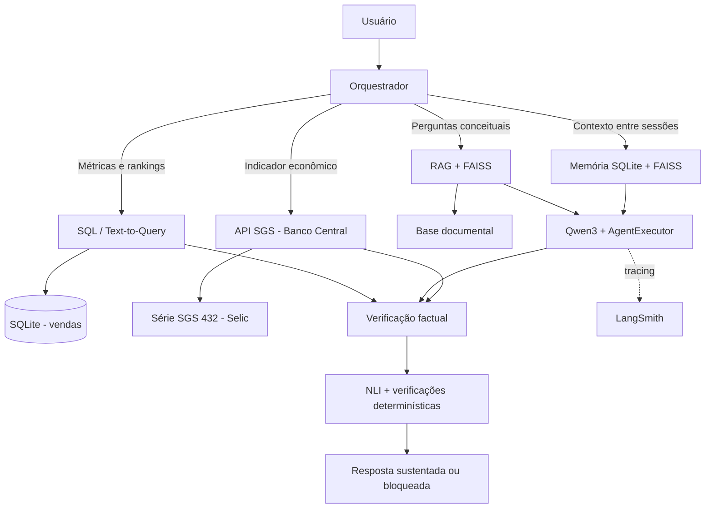

# Business Intelligence Agent

Projeto de pós-graduação em agentes de IA, desenvolvido com Python, LangChain e LangGraph. A solução integra consultas SQL, recuperação documental (RAG), API econômica externa, memória conversacional e persistente, verificação factual por Natural Language Inference (NLI), e observabilidade com LangSmith.

## Objetivo

Construir um agente de Business Intelligence capaz de responder perguntas sobre vendas e regras de negócio, consultar indicadores econômicos oficiais, manter contexto entre interações e bloquear respostas que não sejam sustentadas pelas evidências disponíveis.

## Arquitetura



A demonstração integrada `scripts/run_local_openai_tools_agent.py` utiliza Qwen3 local via Ollama, `create_openai_tools_agent` e `AgentExecutor`. O orquestrador aplica rotas determinísticas para consultas mensais, text-to-query, recuperação de memória pessoal e consultas conceituais via RAG. As evidências das ferramentas são encaminhadas ao verificador antes da liberação da resposta.

O repositório também contém demonstrações didáticas de outras estratégias de agentes, chains e memória; nem todas utilizam inferência generativa real.

## Componentes

### Chains e processamento
- `PromptTemplate` / `ChatPromptTemplate`, LCEL e composição de componentes.
- Execução `invoke`, `batch` e `stream`.
- Chains sequenciais, paralelas e roteamento.
- Saída estruturada com Pydantic, few-shot prompting e estrutura PTCF.

### Agentes e ferramentas
- Agente integrado com `create_openai_tools_agent` e `AgentExecutor`.
- Qwen3 (`qwen3:1.7b`) local por meio da API compatível com OpenAI do Ollama.
- Ferramenta SQL para consultas somente leitura à base SQLite de vendas.
- Text-to-query: o modelo propõe um plano estruturado; o backend valida o catálogo permitido e compila SQL parametrizado e somente leitura.
- RAG documental com FAISS.
- Consulta à API SGS do Banco Central do Brasil, série 432 (Selic).
- Ferramentas de memória pessoal e contextual.

### RAG

A base documental fica em `data/knowledge_base/` e contém glossário de KPIs, dicionário de dados, regras de negócio e fontes/limitações. A recuperação usa embeddings multilíngues e FAISS, com expansão determinística de consultas. O índice persistido é reutilizado durante a avaliação de recuperação; a avaliação não reconstrói o índice.

### Memória

- Memória conversacional de curto prazo por sessão, em RAM, com janela configurada de até oito mensagens na demonstração integrada.
- Memória de longo prazo persistida em SQLite, com categorias semântica, episódica e procedural.
- Recuperação híbrida lexical e semântica com FAISS e Reciprocal Rank Fusion (RRF).
- SQLite permanece como fonte de verdade; o índice vetorial é derivado e reconstruível.

### Verificação factual e guardrails

O verificador usa o modelo multilíngue `MoritzLaurer/mDeBERTa-v3-base-xnli-multilingual-nli-2mil7`, via Transformers e PyTorch. Ele extrai afirmações, seleciona evidências específicas (incluindo definições de campos e fórmulas), classifica as relações como `APOIA`, `REFUTA` ou `NEUTRA` e executa verificações auxiliares de consistência numérica e coerência. Os vereditos gerais são `SUSTENTADA`, `REFUTADA`, `INCONCLUSIVA` ou `INCOERENTE`.

Na rota conceitual de receita líquida e campos físicos, uma única tentativa de revisão pelo Qwen3 pode ser solicitada quando o primeiro rascunho contém afirmações sem suporte ou contraditas. A resposta revisada é verificada novamente; a revisão não altera o threshold do NLI e não garante aprovação. Os escores NLI não são probabilidades calibradas.

## Avaliações e resultados

### Recuperação RAG

O benchmark `docs/AVALIACAO_RAG.md` compara busca original, expandida e híbrida em 14 perguntas, com top-k=4 e avaliação no nível de documento/fonte. Resultados agregados:

| Estratégia | Precision@4 | Recall@4 | MRR |
|---|---:|---:|---:|
| Original | 0,4643 | 0,9762 | 0,9643 |
| Expandida | 0,4821 | 1,0000 | 1,0000 |
| Híbrida | 0,4821 | 1,0000 | 1,0000 |

O benchmark avalia recuperação de fontes, não a correção das respostas geradas. A amostra e os documentos avaliados são limitados.

### Avaliação ao vivo com Qwen3 e LangSmith

A avaliação `scripts/evaluate_live_qwen_agent.py` executa seis cenários reais com `qwen3:1.7b` local, Ollama e tracing do LangSmith. Na execução final de 08/11/2026, os seis cenários receberam veredito `SUSTENTADA`: SQL mensal, Text-to-Query, API Selic, memória multi-turn, RAG conceitual e consulta multi-source (SQL + RAG).

- Dataset: `business-intelligence-agent-qwen3-live-v1`
- Projeto LangSmith: `business-intelligence-agent`
- Experimento: `qwen3-live-agent-evaluation-37b531b2`
- Resultado local: `outputs/qwen3_live_evaluation.json`
- Relatório detalhado: `docs/AVALIACAO_AGENTE_QWEN3.md`
- Evidência: `docs/EVIDENCIAS_LANGSMITH.md`
- Evidências visuais históricas da avaliação mock/determinística (separadas da avaliação live): `docs/EVIDENCIAS_LANGSMITH_MOCK.md` e `docs/ANEXO_EVIDENCIAS_LANGSMITH_MOCK.pdf`.

A avaliação cobre os seis cenários curados; não representa garantia de desempenho para todas as perguntas ou ambientes.

## Tecnologias

Python 3.12, LangChain, LangGraph, LangSmith, Ollama, Qwen3, SQLite, FAISS, Hugging Face Transformers, Sentence Transformers, PyTorch, Pydantic, Pandas, Requests e Pytest.

## Estrutura

```text
business-intelligence-agent/
├── data/knowledge_base/       # Documentos de negócio
├── data/sample/               # Base SQLite de demonstração
├── docs/                      # Avaliações e documentação técnica
├── outputs/                   # Resultados reproduzíveis
├── scripts/                   # Execução, avaliação e preparação
├── src/business_agent/        # Agentes, chains, memória, RAG, tools e NLI
├── tests/                     # Testes automatizados
├── .env.example
├── pyproject.toml
├── requirements.txt
└── README.md
```

## Configuração

Requisitos: Python 3.12, Git, Ollama (para o agente integrado) e conectividade para instalar dependências/baixar modelos.

```powershell
py -3.12 -m venv .venv
.\.venv\Scripts\Activate.ps1
python -m pip install --upgrade pip
pip install -r requirements.txt
pip install -e .
Copy-Item .env.example .env
```

Para tracing remoto, configure `LANGSMITH_TRACING=true`, `LANGSMITH_API_KEY` e `LANGSMITH_PROJECT` no `.env`. Nunca versione `.env` ou chaves.

Baixe o modelo local:

```powershell
ollama pull qwen3:1.7b
```

O script integrado utiliza `http://localhost:11434/v1` e a chave local de compatibilidade `ollama`; não requer créditos da API OpenAI.

## Dados e índices

A base SQLite de demonstração está em `data/sample/sales.db`. Para recriá-la:

```powershell
python scripts/setup_data.py
```

Atenção: o comando recria a base de demonstração e pode sobrescrever alterações locais. Para reconstruir o índice vetorial documental:

```powershell
python scripts/build_faiss_index.py
```

A avaliação RAG descrita acima reutiliza o índice existente e não precisa executar esse comando.

## Executar as demonstrações

### Agente integrado

```powershell
python scripts/run_local_openai_tools_agent.py
```

Exemplos:

```text
Qual foi a receita líquida em setembro de 2026?
Explique a diferença entre receita bruta e receita líquida.
Qual é a meta Selic mais recente?
Compare a receita líquida por categoria em setembro de 2026.
Mostre as três categorias com maior receita líquida.
Lembre-se que nosso KPI principal é receita líquida.
Qual KPI eu mencionei como principal?
```

### Avaliação real Qwen3 + LangSmith

```powershell
python scripts/evaluate_live_qwen_agent.py
```

O script executa os seis cenários sequencialmente para limitar o consumo de memória e salva o relatório em `outputs/qwen3_live_evaluation.json`.

### Outras demonstrações

```powershell
python scripts/run_initial_chain.py --mode simple
python scripts/run_initial_chain.py --mode batch
python scripts/run_initial_chain.py --mode stream
python scripts/run_agent_mock.py
python scripts/run_react_demo.py
python scripts/run_legacy_openai_tools_demo.py
python scripts/test_rag_search.py
python scripts/run_memory_demo.py
python scripts/run_persistent_agent_demo.py
python scripts/run_hybrid_memory_demo.py
python scripts/run_verifier_demo.py
python scripts/check_bcb_api.py
python scripts/check_langsmith.py
python scripts/run_langsmith_trace.py
python scripts/evaluate_business_agent.py
```

As demonstrações mock/determinísticas exercitam fluxos e contratos sem representar inferência de um LLM real.

## Testes automatizados

Executar a suíte completa:

```powershell
pytest -q
```

Última validação registrada em 08/11/2026: **164 testes passaram**, com oito avisos de depreciação/futuro emitidos por dependências. Não houve falhas na suíte.

## Limitações conhecidas

- A avaliação live contém seis cenários curados; não é uma amostra abrangente de interações em produção.
- O benchmark de recuperação RAG contém 14 perguntas, com fontes esperadas definidas manualmente.
- Precision/Recall/MRR medem recuperação de fontes, não correção de respostas.
- Escores NLI não são probabilidades calibradas e não substituem revisão de domínio.
- O Qwen3 local depende do hardware e da configuração de execução; os resultados são específicos ao modelo/ambiente testados.
- O histórico conversacional da demonstração integrada fica em RAM e é perdido ao encerrar o processo; a memória de longo prazo é persistida separadamente.
- Algumas APIs clássicas do LangChain utilizadas em demonstrações didáticas emitem avisos de depreciação; não impediram os testes executados.

## Status da entrega

Na validação de 08/11/2026, a suíte automatizada registrou 164 testes aprovados; o benchmark de recuperação RAG apresentou Recall@4 de 1,0000 para as estratégias expandida e híbrida; e a avaliação ao vivo do Qwen3 no LangSmith obteve veredito `SUSTENTADA` nos seis cenários. A demonstração interativa também liberou uma resposta conceitual sobre receita líquida e campos físicos após revisão única e nova verificação NLI. A gravação do vídeo demonstrativo está planejada como etapa separada.
