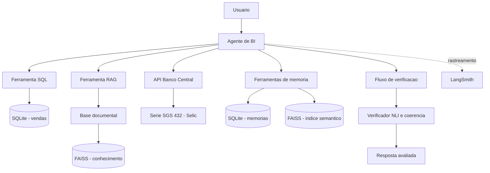

# Business Intelligence Agent

Projeto de pós-graduação em Agentes de IA, desenvolvido com Python, LangChain e LangGraph.

## 1. Objetivo

Construir um agente de Business Intelligence capaz de consultar dados estruturados, recuperar conhecimento documental, acessar uma fonte externa de dados econômicos e manter informações relevantes entre interações.

O projeto explora estratégias de construção e orquestração de agentes, uso de ferramentas, RAG, memória de curto e longo prazo, verificação de respostas e observabilidade.

## 2. Arquitetura



O agente principal utiliza `create_agent` e ferramentas especializadas. Também existem demonstrações legadas/clássicas para fins didáticos.

## 3. Componentes

### Chains e processamento

- `PromptTemplate` e `ChatPromptTemplate`.
- LCEL e composição de componentes.
- Saída estruturada com Pydantic.
- Execução `invoke`, `batch` e `stream`.
- Chains sequenciais e paralelas e roteamento.
- Few-shot prompting e estrutura PTCF.

### Agentes e ferramentas

- Agente principal construído com `create_agent`.
- Checkpointing para persistência de estado conversacional.
- Demonstração ReAct clássica com `initialize_agent`.
- Demonstração com `create_openai_tools_agent` e `AgentExecutor`.
- Ferramenta SQL para consultas somente leitura à base SQLite de vendas.
- Ferramenta RAG para recuperação de conhecimento documental.
- Ferramenta conectada à API SGS do Banco Central do Brasil, série 432 (Selic).
- Ferramentas para gravar e recuperar memórias.

### RAG

A base documental está em `data/knowledge_base/` e contém glossário de KPIs, dicionário de dados, regras de negócio e informações sobre fontes e limitações.

A recuperação utiliza embeddings multilíngues e FAISS. O projeto inclui busca com pontuação de similaridade e mecanismos de transformação/expansão de consultas.

### Memória

A solução contempla memória de curto prazo com checkpointing e memória de longo prazo persistida em SQLite. As memórias são organizadas em categorias semântica, episódica e procedural.

A recuperação de longo prazo combina busca lexical normalizada e busca semântica com embeddings e FAISS. Os rankings são combinados por Reciprocal Rank Fusion (RRF). O SQLite é a fonte de verdade; o índice FAISS é derivado e reconstruível.

### Verificação

Foi implementado um verificador local baseado em Natural Language Inference (NLI), que classifica a relação entre afirmações e evidências como entailment, contradiction ou neutral. Há verificações auxiliares de consistência numérica e coerência lógica.

O verificador é uma camada de apoio à validação, não uma garantia absoluta de correção factual. Os escores do classificador não devem ser interpretados automaticamente como probabilidades calibradas.

### Observabilidade e avaliação

O projeto integra LangSmith para rastreamento e avaliação. O conjunto de avaliação contém cinco cenários e duas métricas: cobertura de termos esperados na resposta (*answer coverage*) e aderência à trajetória/ferramentas esperadas (*trajectory*).

**Limitação importante:** a avaliação automatizada do agente usa um modelo determinístico simulado. Os resultados medem o comportamento do fluxo controlado de teste, não a qualidade geral ou autonomia de um LLM em produção.

## 4. Tecnologias

- Python 3.12
- LangChain, LangGraph e LangSmith
- SQLite
- FAISS
- Hugging Face Sentence Transformers
- Pydantic
- Pandas e Requests
- Pytest

## 5. Estrutura do projeto

```text
business-intelligence-agent/
├── data/
│   ├── knowledge_base/
│   └── sample/
├── docs/
├── outputs/
├── scripts/
├── src/business_agent/
│   ├── agents/
│   ├── chains/
│   ├── memory/
│   ├── observability/
│   ├── retrieval/
│   ├── tools/
│   └── verification/
├── tests/
├── .env.example
├── .gitignore
├── pyproject.toml
├── requirements.txt
└── README.md
```

## 6. Configuração do ambiente

Requisitos: Python 3.12, Git e acesso à internet para instalar dependências e baixar os modelos Hugging Face na primeira execução.

No PowerShell, na raiz do repositório:

```powershell
py -3.12 -m venv .venv
.\.venv\Scripts\Activate.ps1
python -m pip install --upgrade pip
pip install -r requirements.txt
pip install -e .
```

Crie o arquivo local de variáveis de ambiente:

```powershell
Copy-Item .env.example .env
```

Para habilitar o rastreamento remoto, configure `LANGSMITH_TRACING=true`, `LANGSMITH_API_KEY` e `LANGSMITH_PROJECT` no `.env`. Não versione nem compartilhe o arquivo `.env` ou suas chaves.

As demonstrações com modelos determinísticos simulados não exigem créditos de API da OpenAI. A presença de `OPENAI_API_KEY` e `OPENAI_MODEL` no `.env.example` não significa que os testes automatizados estejam chamando um modelo OpenAI real.

## 7. Preparação dos dados e índices

A base SQLite de vendas de demonstração está em `data/sample/sales.db` e também está versionada no repositório. Para recriá-la:

```powershell
python scripts/setup_data.py
```

**Atenção:** esse script recria a base de demonstração; alterações locais em `sales.db` podem ser substituídas.

Para construir o índice vetorial da base documental:

```powershell
python scripts/build_faiss_index.py
```

Na primeira execução, o modelo de embeddings pode precisar ser baixado do Hugging Face.

## 8. Executar demonstrações

### Chains

```powershell
python scripts/run_initial_chain.py --mode simple
python scripts/run_initial_chain.py --mode batch
python scripts/run_initial_chain.py --mode stream
```

Os modos demonstrativos utilizam implementações simuladas/determinísticas; não devem ser apresentados como inferência realizada por um LLM externo.

### Agentes

```powershell
python scripts/run_agent_mock.py
python scripts/run_react_demo.py
python scripts/run_legacy_openai_tools_demo.py
```

As demonstrações de agentes com mock exercitam o fluxo de chamadas de ferramentas sem depender de créditos de LLM.

### RAG e memória

```powershell
python scripts/test_rag_search.py
python scripts/run_memory_demo.py
python scripts/run_persistent_agent_demo.py
python scripts/run_hybrid_memory_demo.py
```

### Verificador NLI

```powershell
python scripts/run_verifier_demo.py
```

### Integração com Banco Central

```powershell
python scripts/check_bcb_api.py
```

Esse teste consulta a API externa e depende de conectividade.

## 9. LangSmith

Verificar a configuração:

```powershell
python scripts/check_langsmith.py
```

Executar um rastreamento:

```powershell
python scripts/run_langsmith_trace.py
```

Executar a avaliação local:

```powershell
python scripts/evaluate_business_agent.py
```

Enviar o conjunto de avaliação e executar a avaliação remota:

```powershell
python scripts/evaluate_business_agent.py --upload
```

O resultado local da avaliação é salvo em `outputs/business_agent_evaluation.json`.

## 10. Testes automatizados

Executar a suíte completa:

```powershell
python -m pytest -q
```

No último ciclo registrado de validação, foram aprovados 91 testes. Esse número deve ser atualizado caso a suíte mude.

## 11. Documentação complementar

A comparação entre frameworks de memória está em `docs/COMPARACAO_FRAMEWORKS_MEMORIA.md`. O documento compara SQLite, LangMem e Mem0 e registra os critérios e decisões arquiteturais adotados.

## 12. Limitações e considerações

- Os modelos determinísticos simulados permitem reproduzir fluxos sem depender de créditos de LLM; não demonstram autonomia ou qualidade de um modelo generativo real.
- A avaliação no LangSmith utiliza cinco cenários controlados e não representa uma validação abrangente de qualidade de respostas de LLM.
- RRF combina posições nos rankings e não é uma probabilidade de relevância.
- Os escores NLI não são necessariamente probabilidades calibradas.
- A verificação numérica é auxiliar e não substitui uma validação semântica completa.
- Algumas demonstrações preservam componentes clássicos do LangChain para fins didáticos e podem emitir avisos de depreciação.

## 13. Status

A implementação contempla chains, agentes, ferramentas, RAG, memória, verificação e observabilidade. A última validação registrada da suíte automatizada resultou em 91 testes aprovados.

A revisão final dos requisitos acadêmicos, a consolidação do relatório e a preparação da apresentação são etapas de finalização da entrega.
