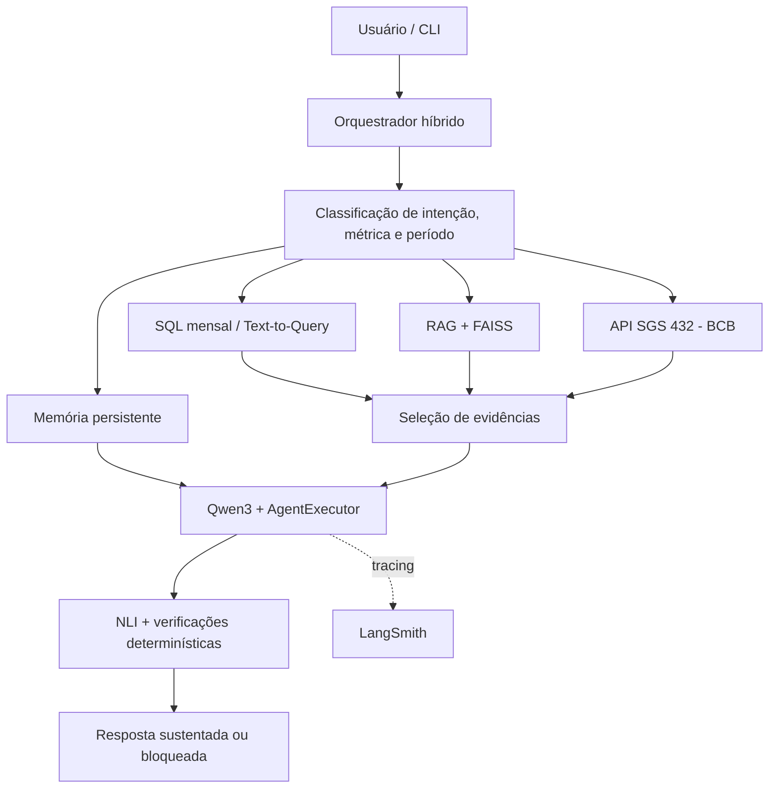

# Business Intelligence Agent

Projeto acadêmico de agentes de IA desenvolvido com Python, LangChain e LangGraph. A solução integra consultas SQL, Text-to-Query, recuperação documental (RAG), API econômica externa, memória conversacional e persistente, verificação factual por Natural Language Inference (NLI) e avaliação/observabilidade com LangSmith.

## Objetivo e domínio

Construir um agente de Business Intelligence para responder perguntas sobre vendas, regras de negócio e indicadores econômicos. O agente deve selecionar fontes adequadas, executar ferramentas, preservar contexto entre turnos e evitar liberar respostas que não sejam sustentadas pelas evidências disponíveis.

O domínio de demonstração é análise de vendas. A tabela `sales` possui os campos físicos `sale_id`, `sale_date`, `product`, `category`, `region`, `quantity`, `unit_price` e `discount_pct`. As regras documentadas definem:

- Receita bruta por item: `quantity × unit_price`.
- Desconto por item: `quantity × unit_price × discount_pct`.
- Receita líquida por item: `quantity × unit_price × (1 - discount_pct)`.

A base SQLite e os documentos da pasta `data/` são artefatos locais de demonstração. A API econômica externa consulta a série SGS 432 do Banco Central do Brasil (meta Selic).

## Arquitetura cognitiva e maturidade

A arquitetura é **híbrida**: combina rotas determinísticas para perguntas conhecidas (identificação de métricas, períodos, SQL mensal e consultas conceituais específicas) com seleção de ferramentas por LLM no `AgentExecutor` para perguntas que exigem interpretação e uso de ferramentas. Em consultas multi-source, o fluxo combina SQL para valores e RAG para conceitos/fórmulas, e encaminha as evidências ao verificador factual.

Em uma classificação qualitativa de maturidade (não um padrão universal), o projeto está no estágio de **protótipo integrado com uso de ferramentas e memória**, acima de uma chain fixa/LLM isolado. Ainda não é um agente autônomo de produção: o planejamento é delimitado por regras e planos estruturados, a avaliação live cobre seis cenários curados e a persistência conversacional de curto prazo permanece em RAM por sessão.

Planejamento de uma solicitação complexa:

1. Normalizar a pergunta e identificar intenção, métrica, período e entidades/dimensões relevantes.
2. Selecionar uma ou mais fontes (SQLite/SQL, RAG/FAISS, API SGS 432 ou memória persistente).
3. Para Text-to-Query, solicitar ao modelo um plano JSON restrito; validar métrica, dimensão, ordenação e limite; compilar/executar a consulta parametrizada em modo somente leitura.
4. Para solicitações multi-source, combinar o valor quantitativo retornado pelo SQL com a definição ou fórmula recuperada pelo RAG.
5. Selecionar evidências e verificar afirmações, números e coerência antes de liberar a resposta.

O planejamento é decomposto em etapas e fontes, mas não há um planner hierárquico autônomo que crie subagentes ou planos recursivos.

## Arquitetura e fluxo



A demonstração integrada principal é `scripts/run_local_openai_tools_agent.py`, que utiliza Qwen3 local via Ollama, `create_openai_tools_agent`, `AgentExecutor` e `RunnableWithMessageHistory`. Há rotas especializadas determinísticas antes/de fora do loop padrão do executor; as perguntas que requerem seleção semântica de ferramentas seguem para o LLM e o executor. O projeto também mantém demonstrações didáticas de chains, RouterChain, ReAct e memória.

## Chains, prompts e saída estruturada

`src/business_agent/chains/initial_chain.py` implementa `PromptTemplate`, `ChatPromptTemplate`, `PydanticOutputParser` e o modelo Pydantic `RequestAnalysis`. A chain oferece saída estruturada com intenção, métrica, período, necessidade de ferramentas e informações ausentes.

A mesma chain é composta em dois estilos:

- **LCEL (declarativo):** `chat_prompt | structured_llm | output_parser`. É o padrão recomendado para transformações lineares e legíveis, com componentes substituíveis.
- **`@chain` (imperativo):** chama `invoke` em cada componente e permite inserir validações e ramificações Python. Foi mantido para comparação e para fluxos que precisem de controle explícito.

A interface `Runnable` é demonstrada por `invoke`, `batch` e `stream` em `scripts/run_initial_chain.py`. O modo padrão da chain inicial é `mock` (sem chamada externa); `LLM_MODE=openai` habilita a execução com chave configurada.

`src/business_agent/chains/advanced_chains.py` demonstra composição sequencial (`RunnableLambda`), paralela (`RunnableParallel`) e roteamento clássico com `RouterChain`. A classificação/extração nessa etapa é determinística, facilitando teste e rastreabilidade.

## Agentes, orquestração e prompts

O agente integrador usa `create_openai_tools_agent` e `AgentExecutor`, com o prompt contendo Persona, Task, Context e Format (PTCF), exemplos few-shot e `agent_scratchpad` para mensagens de ações/resultados de ferramentas.

A escolha de LangChain é adequada ao caso de uso de um único agente que precisa de abstrações reutilizáveis para modelos, prompts, tools e um loop de chamadas de ferramentas. A comparação de desenho é:

| Orquestrador | Ponto forte | Adequação a este projeto |
|---|---|---|
| LangChain AgentExecutor | Loop de agente com integração direta a prompts, modelos e tools. | Escolhido para o agente integrador e para demonstrar `create_openai_tools_agent` + `AgentExecutor`. |
| LangGraph | Workflow em grafo com estado explícito, nós/arestas, persistência/checkpoint e controle de fluxo. | Complementar para fluxos com transições e estado mais elaborados; seria a evolução natural se o processo se tornasse mais longo ou ramificado. |
| CrewAI | Abstrações de crews/agents com papéis, tarefas e colaboração multiagente; Flows coordenam o processo. | Não escolhido porque o domínio atual é resolvido por um agente de BI que coordena ferramentas, sem necessidade demonstrada de equipe de agentes especializados. |

A comparação é arquitetural, não um benchmark de desempenho entre frameworks. Referências oficiais consultadas estão no final deste README.

**ReAct clássico:** `src/business_agent/agents/legacy_react.py` implementa `initialize_agent` com `AgentType.ZERO_SHOT_REACT_DESCRIPTION`, e `scripts/run_react_demo.py` imprime as etapas intermediárias. Nesta demonstração didática, o modelo é `FakeListLLM` para tornar a trajetória determinística; as ferramentas de SQL e API do Banco Central são reais. Portanto, o ciclo ReAct clássico está no código, mas a decisão de ferramenta dessa demonstração específica não é gerada por um LLM ao vivo. O agente integrador separado utiliza Qwen3 real.

**Raciocínio e rastreabilidade:** o projeto usa decomposição da tarefa, `agent_scratchpad`, exemplos few-shot e rastros de chamadas/observações. Não registra nem apresenta cadeia de pensamento privada em texto livre; para depuração, registra resumos de plano, ferramentas e resultados. Assim, o requisito de raciocínio operacional é demonstrado, mas a interpretação literal de chain-of-thought textual explícito é uma limitação deliberada.

## Ferramentas: determinísticas, semânticas e híbridas

| Tipo | Componentes | Comportamento |
|---|---|---|
| Determinísticas / hardcoded | `sales_monthly_summary`, parser/resolvedor de períodos, seleção de métricas, validações e verificações numéricas. | Executam regras e consultas com parâmetros e catálogo controlados; não delegam a criação livre de SQL ao modelo. |
| Semânticas | `business_knowledge_search`, `search_business_memory` e seleção de ferramentas no AgentExecutor. | Recebem consultas em linguagem natural; o modelo decide quando consultar conhecimento ou memória e fornece a consulta textual. |
| Híbrida | `text_to_query_sales`. | Qwen3 propõe plano JSON limitado; `parse_query_plan` valida chaves, métricas, dimensões, ordenação e limite; o backend compila/executa a consulta segura. |
| API externa | `get_selic_target`. | Wrapper tipado consulta a API pública do Banco Central, trata falhas HTTP/JSON e retorna observações, datas, unidade e fonte. |

A API SGS 432 não exige chave de autenticação, mas exige conectividade com a internet. O tracing remoto do LangSmith depende de `LANGSMITH_API_KEY`. O arquivo `.env.example` contém apenas placeholders vazios; nunca versione `.env` nem credenciais reais.

## Text-to-Query e RAG

Text-to-Query não aceita SQL livre produzido pelo modelo. O prompt solicita exatamente `metric`, `dimension`, `sort` e `limit`; o parser valida os valores contra listas permitidas e o backend executa a consulta em modo somente leitura.

O RAG utiliza o índice FAISS persistido em `data/indexes/business_knowledge_faiss`, carregado por `load_faiss_index`. A avaliação documentada reutiliza o índice existente; não reconstrói o pipeline de indexação. A recuperação usa embeddings multilíngues e expansão determinística da consulta.

### Diagnóstico de falha real de recuperação

No caso RAG-02 (“Como descobrir o faturamento após os descontos?”), a busca original recuperou o glossário e o dicionário de dados, mas não retornou as regras de negócio também marcadas como relevantes. A pergunta usava “faturamento após descontos”, enquanto a base formalizava o conceito como “receita líquida”. A expansão acrescentou termos equivalentes (`receita líquida`, `receita bruta`, `descontos`, `quantity`, `unit_price`, `discount_pct`) e recuperou as três fontes esperadas.

Em 14 perguntas (top-k=4), os resultados foram:

| Estratégia | Precision@4 | Recall@4 | MRR |
|---|---:|---:|---:|
| Original | 0,4643 | 0,9762 | 0,9643 |
| Expandida | 0,4821 | 1,0000 | 1,0000 |
| Híbrida | 0,4821 | 1,0000 | 1,0000 |

Os ganhos são concentrados em casos de incompatibilidade vocabular. Expandida e híbrida empataram nesse benchmark; as métricas avaliam recuperação documental, não a correção das respostas do LLM.

## Memória: curto prazo, longo prazo e CoALA

A memória de curto prazo é gerenciada por sessão em RAM. `build_agent_with_session_history` envolve o `AgentExecutor` com `RunnableWithMessageHistory` e mantém uma janela deslizante de até oito mensagens anteriores (aproximadamente quatro turnos). Quando excede o limite, remove mensagens antigas e preserva a janela começando por uma mensagem do usuário. O histórico volátil é perdido ao encerrar o processo. Também há uma factory didática `build_conversation_buffer_memory()` que instancia `ConversationBufferMemory`; o runtime integrador usa `RunnableWithMessageHistory`.

A memória de longo prazo é persistida em SQLite e classificada pela taxonomia CoALA:

- **Semântica:** fatos e definições estáveis do negócio.
- **Episódica:** análises e eventos com período, fonte e contexto.
- **Procedural:** instruções e procedimentos recorrentes.

`HybridMemoryRetriever` combina busca lexical do SQLite e similaridade vetorial do FAISS, com Reciprocal Rank Fusion (RRF). SQLite permanece como fonte persistente de verdade; FAISS é um índice derivado e reconstruível. Não há sumarização automática do histórico conversacional: o controle de contexto é feito pela janela deslizante e a memória persistente é recuperada sob demanda.

A comparação entre SQLite próprio, LangMem e Mem0 está em `docs/COMPARACAO_FRAMEWORKS_MEMORIA.md`. Não foram executados benchmarks de desempenho entre essas ferramentas.

## Verificação factual, coerência e confiabilidade

`src/business_agent/verification/nli_verifier.py` usa o modelo multilíngue `MoritzLaurer/mDeBERTa-v3-base-xnli-multilingual-nli-2mil7` via Transformers/PyTorch. O verificador decompõe respostas em afirmações, seleciona evidências, classifica relações como `APOIA`, `REFUTA` ou `NEUTRA`, e aplica controles determinísticos para correspondência de métricas, valores e coerência. Os vereditos gerais são `SUSTENTADA`, `REFUTADA`, `INCONCLUSIVA` ou `INCOERENTE`.

O projeto implementa `AgentLoggingCallbackHandler` em `observability/callbacks.py`. O handler registra início/fim/erro de chamadas de ferramentas, LLM e chains sem registrar conteúdo sensível. A implementação está disponível, mas não é injetada como callback no runtime CLI principal; o tracing efetivo de execução é feito pelo LangSmith.

## Avaliações e resultados

### Testes automatizados

A última execução informada no ambiente local em 09/11/2026 foi de **182 testes aprovados**, com oito avisos de depreciação/futuro emitidos por dependências e nenhuma falha. Reproduzir com:

```powershell
pytest -q
```

### Avaliação live Qwen3 + LangSmith

- Modelo: `qwen3:1.7b` local via Ollama.
- Dataset: `business-intelligence-agent-qwen3-live-v1`.
- Projeto: `business-intelligence-agent`.
- Experimento: `qwen3-live-agent-evaluation-37b531b2`.
- Cenários: SQL mensal, Text-to-Query, API Selic, memória multi-turn, RAG conceitual e multi-source.
- Verificação NLI: 6/6 cenários com veredito `SUSTENTADA`.

O script define quatro avaliadores: precisão da trajetória, recall da trajetória, cobertura de termos obrigatórios e veredito de sustentação. Recalculando as métricas a partir do arquivo `outputs/qwen3_live_evaluation.json` com as mesmas definições do script, os seis casos apresentaram **100% de precisão e 100% de recall das chamadas de ferramentas esperadas**. A cobertura média de termos obrigatórios foi **94,4%**: cinco cenários atingiram 100% e o cenário multi-source atingiu 66,7%, pois a resposta não mencionou literalmente o campo `discount_pct`. A métrica é cobertura lexical de termos especificados, não avaliação semântica completa da resposta.

Resultados por cenário e links:

| Cenário | Ferramentas esperadas e observadas | NLI |
|---|---|---|
| `monthly_sql` | `sales_monthly_summary` | SUSTENTADA |
| `text_to_query` | `text_to_query_sales` | SUSTENTADA |
| `external_api` | `get_selic_target` | SUSTENTADA |
| `multi_turn_memory` | `sales_monthly_summary` (2 chamadas) | SUSTENTADA |
| `rag_conceptual` | `business_knowledge_search` | SUSTENTADA |
| `multi_source` | `sales_monthly_summary` + `business_knowledge_search` | SUSTENTADA |

[ Abrir experimento final no LangSmith ](https://smith.langchain.com/o/647ba4a7-e48d-499d-8d39-36bbf1042aeb/datasets/89d20358-ec83-4d57-91ad-e61482a5111a/compare?selectedSessions=b05e999c-94c3-40d1-bbb1-e626c6eea974)

Arquivos de evidência: `outputs/qwen3_live_evaluation.json`, `docs/AVALIACAO_AGENTE_QWEN3.md` e `docs/EVIDENCIAS_LANGSMITH.md`. As evidências mock/determinísticas estão separadas em `docs/EVIDENCIAS_LANGSMITH_MOCK.md` e `docs/ANEXO_EVIDENCIAS_LANGSMITH_MOCK.pdf`; não substituem a avaliação live.

### Limitações da avaliação

- São seis cenários curados, não uma amostra abrangente de produção.
- A avaliação multi-turn cobre uma conversa curta de dois turnos; não comprova persistência do histórico após reinicialização.
- Escores NLI não são probabilidades calibradas e não substituem validação humana.
- O benchmark RAG tem 14 perguntas e quatro documentos Markdown; os resultados dependem das fontes esperadas definidas manualmente.
- O caso multi-source não atingiu cobertura lexical completa porque `discount_pct` não foi mencionado na resposta.

## Estrutura

```text
business-intelligence-agent/
├── data/knowledge_base/       # Glossário, dicionário, regras e fontes
├── data/sample/               # Base SQLite de demonstração
├── data/indexes/              # Índices FAISS persistidos
├── docs/                      # Relatórios, benchmarks e evidências
├── outputs/                   # Resultados JSON/CSV reproduzíveis
├── scripts/                   # Execução, avaliação e preparação
├── src/business_agent/        # Chains, agents, memória, retrieval, tools e NLI
├── tests/                     # Testes automatizados
├── .env.example
├── pyproject.toml
├── requirements.txt
└── README.md
```

## Configuração e reprodução

Requisitos: Python 3.12, Git, Ollama (agente integrador) e conectividade para instalar dependências/baixar modelos.

```powershell
py -3.12 -m venv .venv
.\.venv\Scripts\Activate.ps1
python -m pip install --upgrade pip
pip install -r requirements.txt
pip install -e .
Copy-Item .env.example .env
ollama pull qwen3:1.7b
```

Para tracing e avaliação remota, preencher `LANGSMITH_TRACING=true`, `LANGSMITH_API_KEY` e `LANGSMITH_PROJECT` no `.env`. Não versionar credenciais. O modelo Qwen3 roda localmente no Ollama em `http://localhost:11434/v1`; a chave `ollama` usada pelo cliente é apenas compatibilidade local e não é uma chave OpenAI.

Base e índice de demonstração já estão no repositório. `python scripts/setup_data.py` recria a base SQLite e pode sobrescrever dados locais; `python scripts/build_faiss_index.py` reconstrói o índice documental. O benchmark RAG usa o índice persistido e não precisa reconstruí-lo.

### Agente integrador

```powershell
python scripts/run_local_openai_tools_agent.py
```

### Avaliação live Qwen3 + LangSmith

```powershell
python scripts/evaluate_live_qwen_agent.py
```

### Chain inicial

```powershell
python scripts/run_initial_chain.py --mode json
python scripts/run_initial_chain.py --mode imperative
python scripts/run_initial_chain.py --mode batch
python scripts/run_initial_chain.py --mode stream
```

### ReAct clássico e outras demonstrações

```powershell
python scripts/run_react_demo.py
python scripts/run_agent_mock.py
python scripts/run_memory_demo.py
python scripts/run_hybrid_memory_demo.py
python scripts/run_verifier_demo.py
python scripts/check_bcb_api.py
python scripts/check_langsmith.py
python scripts/evaluate_rag_retrieval.py
```

O modo ReAct usa LLM simulado por decisão didática; a API e a ferramenta SQL acionadas no fluxo continuam reais. Testes automatizados usam mocks quando adequado para execução sem credenciais externas.

## Referências técnicas

1. LangChain Reference - `create_openai_tools_agent`: https://reference.langchain.com/python/langchain-classic/agents/openai_tools/base/create_openai_tools_agent
2. LangGraph - Overview: https://docs.langchain.com/oss/python/langgraph/overview
3. CrewAI - Introduction: https://docs.crewai.com/en/introduction
4. LangChain OSS - Overview: https://www.langchain.com/oss-overview

A comparação dos frameworks é de natureza arquitetural; não foi executado benchmark de latência, custo ou qualidade entre eles.
