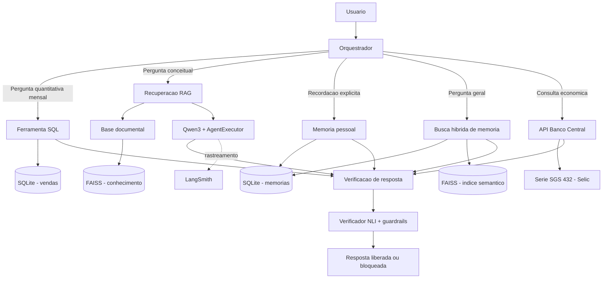

# Business Intelligence Agent

Projeto de pós-graduação em agentes de IA, desenvolvido com Python, LangChain e LangGraph. A solução combina consultas SQL, recuperação documental (RAG), consulta a uma API econômica, memória conversacional e persistente e verificação factual baseada em Natural Language Inference (NLI).

## 1. Objetivo

Construir um agente de Business Intelligence capaz de responder perguntas sobre dados de vendas e regras de negócio, consultar uma fonte externa de indicadores econômicos e preservar informações relevantes entre interações.

O projeto explora chains, agentes e ferramentas, diferentes estratégias de orquestração, RAG, memória de curto e longo prazo, verificação de respostas e observabilidade.

## 2. Arquitetura



O repositório reúne mais de uma abordagem de agentes para fins didáticos. A demonstração interativa integrada `scripts/run_local_openai_tools_agent.py`, validada com o modelo local Qwen3, utiliza `create_openai_tools_agent` e `AgentExecutor`. Há também demonstrações de outras estratégias, incluindo `create_agent` e ReAct clássico.

Na demonstração integrada, o orquestrador aplica rotas determinísticas antes de recorrer ao modelo:

1. Perguntas de recordação pessoal consultam diretamente memórias explicitamente salvas.
2. Perguntas quantitativas mensais são resolvidas por SQL, que permanece como fonte de verdade para os valores.
3. Perguntas conceituais consultam primeiro a base RAG; as evidências recuperadas são então fornecidas ao Qwen3 para formular a resposta.
4. Perguntas gerais podem recuperar contexto por meio da busca híbrida de memória antes de chamar o agente.

As respostas geradas são verificadas contra as observações das ferramentas. A resposta original só é liberada quando o verificador classifica todas as afirmações como sustentadas.

## 3. Componentes

### Chains e processamento

- `PromptTemplate` e `ChatPromptTemplate`.
- LCEL e composição de componentes.
- Saída estruturada com Pydantic.
- Execução `invoke`, `batch` e `stream`.
- Chains sequenciais e paralelas e roteamento.
- Few-shot prompting e estrutura PTCF.

### Agentes e ferramentas

- Demonstração integrada com `create_openai_tools_agent` e `AgentExecutor`.
- Execução local do Qwen3 por meio da interface compatível com a API da OpenAI fornecida pelo Ollama.
- Demonstrações adicionais com `create_agent` e ReAct clássico.
- Ferramenta SQL para consultas somente leitura à base SQLite de vendas.
- Ferramenta RAG para recuperação de conhecimento documental.
- Ferramenta conectada à API SGS do Banco Central do Brasil, série 432 (Selic).
- Ferramentas para gravar e recuperar memórias.

### RAG

A base documental está em `data/knowledge_base/` e contém glossário de KPIs, dicionário de dados, regras de negócio e informações sobre fontes e limitações.

A recuperação utiliza embeddings multilíngues e FAISS. O projeto inclui expansão de consultas e recuperação de trechos relevantes. Na verificação, os trechos recuperados são separados por documento de origem para que cada afirmação seja comparada com evidências identificáveis.

### Memória

A solução contempla memória de curto prazo e memória de longo prazo:

- Na demonstração integrada com Qwen3, o histórico conversacional mantém até oito mensagens anteriores em memória RAM e é perdido quando o processo termina.
- A memória de longo prazo é persistida em SQLite e organizada em categorias semântica, episódica e procedural.
- A recuperação de longo prazo combina busca lexical normalizada e busca semântica com embeddings e FAISS.
- Os rankings são combinados por Reciprocal Rank Fusion (RRF). O SQLite é a fonte de verdade; o índice FAISS é derivado e reconstruível.
- Memórias pessoais explícitas são gravadas quando o usuário utiliza uma solicitação de salvamento, como “Lembre-se que...” ou “Guarde na memória:...”.

O repositório também contém demonstrações de estratégias de persistência de estado conversacional com LangGraph.

### Verificação factual

Foi implementado um verificador local de Natural Language Inference (NLI), baseado no modelo multilíngue `MoritzLaurer/mDeBERTa-v3-base-xnli-multilingual-nli-2mil7`, executado com Transformers e PyTorch.

O fluxo:

- extrai afirmações da resposta;
- compara cada afirmação com evidências provenientes das ferramentas;
- classifica a relação como `APOIA`, `REFUTA` ou `NEUTRA`;
- aplica verificações auxiliares de consistência numérica e coerência lógica;
- produz um veredito geral: `SUSTENTADA`, `REFUTADA`, `INCONCLUSIVA` ou `INCOERENTE`.

Quando a resposta não é sustentada, ela não é liberada pelo executor. O verificador é uma camada de apoio à validação, não uma garantia absoluta de correção factual. Os escores do classificador não devem ser interpretados automaticamente como probabilidades calibradas.

### Observabilidade e avaliação

O projeto integra LangSmith para rastreamento e avaliação. O conjunto de avaliação contém cinco cenários e duas métricas: cobertura de termos esperados na resposta (*answer coverage*) e aderência à trajetória/ferramentas esperadas (*trajectory*).

**Limitação importante:** a avaliação automatizada do agente usa um modelo determinístico simulado. Os resultados medem o comportamento do fluxo controlado de teste, não a qualidade geral ou autonomia de um LLM em produção. A demonstração integrada com Qwen3 é executada separadamente, em ambiente local.

## 4. Tecnologias

- Python 3.12
- LangChain, LangGraph e LangSmith
- Ollama e Qwen3 (`qwen3:1.7b`) para a demonstração integrada local
- SQLite
- FAISS
- Hugging Face Transformers e Sentence Transformers
- PyTorch
- Pydantic
- Pandas e Requests
- Pytest

## 5. Estrutura do projeto

```text
business-intelligence-agent/
├── data/
│   ├── knowledge_base/
│   └── sample/
├── docs/
├── outputs/
├── scripts/
├── src/business_agent/
│   ├── agents/
│   ├── chains/
│   ├── memory/
│   ├── observability/
│   ├── retrieval/
│   ├── tools/
│   └── verification/
├── tests/
├── .env.example
├── .gitignore
├── pyproject.toml
├── requirements.txt
└── README.md
```

## 6. Configuração do ambiente

Requisitos: Python 3.12, Git, Ollama (para a demonstração integrada com Qwen3) e acesso à internet para instalar dependências e baixar os modelos do Hugging Face na primeira execução.

No PowerShell, na raiz do repositório:

```powershell
py -3.12 -m venv .venv
.\.venv\Scripts\Activate.ps1
python -m pip install --upgrade pip
pip install -r requirements.txt
pip install -e .
```

Crie o arquivo local de variáveis de ambiente:

```powershell
Copy-Item .env.example .env
```

Para habilitar o rastreamento remoto, configure `LANGSMITH_TRACING=true`, `LANGSMITH_API_KEY` e `LANGSMITH_PROJECT` no `.env`. Não versione nem compartilhe o arquivo `.env` ou suas chaves.

O script `run_local_openai_tools_agent.py` configura diretamente o endpoint local `http://localhost:11434/v1`, o modelo `qwen3:1.7b` e a chave local de compatibilidade `ollama`. Portanto, essa demonstração não precisa de créditos nem de uma chave da API OpenAI. As variáveis `OPENAI_API_KEY` e `OPENAI_MODEL` presentes no `.env.example` são usadas por outras demonstrações/configurações, não pela execução local descrita nesta seção.

### Preparar o Qwen3 no Ollama

Com o Ollama instalado e em execução, baixe o modelo utilizado pelo script:

```powershell
ollama pull qwen3:1.7b
```

O script espera que o serviço local do Ollama esteja acessível em `http://localhost:11434`. Se alterar o modelo ou endpoint, ajuste a configuração em `scripts/run_local_openai_tools_agent.py`.

## 7. Preparação dos dados e índices

A base SQLite de vendas de demonstração está em `data/sample/sales.db` e também está versionada no repositório. Para recriá-la:

```powershell
python scripts/setup_data.py
```

**Atenção:** esse script recria a base de demonstração; alterações locais em `sales.db` podem ser substituídas.

Para construir o índice vetorial da base documental:

```powershell
python scripts/build_faiss_index.py
```

Na primeira execução, os modelos de embeddings e NLI podem precisar ser baixados do Hugging Face. A inicialização pode levar mais tempo na primeira execução.

## 8. Executar demonstrações

### Agente integrado local: Qwen3 + SQL + RAG + memória + NLI

Com o ambiente virtual ativado e o Ollama em execução:

```powershell
python scripts/run_local_openai_tools_agent.py
```

O programa disponibiliza as ferramentas `sales_monthly_summary`, `business_knowledge_search`, `get_selic_target` e `search_business_memory`. Digite perguntas em português no terminal; digite `sair` para encerrar.

Exemplos de perguntas para demonstrar as rotas:

```text
Qual foi a receita líquida em setembro de 2026?
Explique a diferença entre receita bruta e receita líquida.
Qual é a meta Selic mais recente?
Lembre-se que nosso KPI principal é receita líquida.
Qual KPI eu mencionei como principal?
```

As perguntas quantitativas mensais são resolvidas pela rota SQL determinística. As perguntas conceituais consultam o RAG antes da geração com Qwen3. A recuperação de memórias pessoais explícitas é feita diretamente na memória persistente. As respostas passam pelo verificador antes de serem liberadas.

### Chains

```powershell
python scripts/run_initial_chain.py --mode simple
python scripts/run_initial_chain.py --mode batch
python scripts/run_initial_chain.py --mode stream
```

Os modos demonstrativos utilizam implementações simuladas/determinísticas; não devem ser apresentados como inferência realizada por um LLM externo.

### Outras demonstrações de agentes

```powershell
python scripts/run_agent_mock.py
python scripts/run_react_demo.py
python scripts/run_legacy_openai_tools_demo.py
```

As demonstrações de agentes com mock exercitam o fluxo de chamadas de ferramentas sem depender de créditos de LLM.

### RAG e memória

```powershell
python scripts/test_rag_search.py
python scripts/run_memory_demo.py
python scripts/run_persistent_agent_demo.py
python scripts/run_hybrid_memory_demo.py
```

### Verificador NLI

```powershell
python scripts/run_verifier_demo.py
```

### Integração com Banco Central

```powershell
python scripts/check_bcb_api.py
```

Esse teste consulta a API externa e depende de conectividade.

## 9. LangSmith

Verificar a configuração:

```powershell
python scripts/check_langsmith.py
```

Executar um rastreamento:

```powershell
python scripts/run_langsmith_trace.py
```

Executar a avaliação local:

```powershell
python scripts/evaluate_business_agent.py
```

Enviar o conjunto de avaliação e executar a avaliação remota:

```powershell
python scripts/evaluate_business_agent.py --upload
```

O resultado local da avaliação é salvo em `outputs/business_agent_evaluation.json`.

## 10. Testes automatizados

Executar a suíte completa:

```powershell
python -m pytest -q
```

Na última validação registrada durante a preparação desta entrega, **112 testes passaram**. A suíte pode mudar conforme novas funcionalidades e testes forem adicionados. Os avisos de depreciação emitidos por algumas dependências não representaram falhas nessa execução.

## 11. Documentação complementar

A comparação entre frameworks de memória está em `docs/COMPARACAO_FRAMEWORKS_MEMORIA.md`. O documento compara SQLite, LangMem e Mem0 e registra os critérios e decisões arquiteturais adotados.

## 12. Limitações e considerações

- Os modelos determinísticos simulados permitem reproduzir fluxos sem depender de créditos de LLM; não demonstram autonomia ou qualidade de um modelo generativo real.
- A avaliação no LangSmith utiliza cinco cenários controlados e não representa uma validação abrangente da qualidade de respostas de LLM.
- A demonstração integrada usa Qwen3 local por meio do Ollama; seu comportamento depende do modelo e dos recursos disponíveis na máquina.
- O histórico conversacional da demonstração integrada fica em RAM e é perdido ao encerrar o processo; a memória de longo prazo é persistida separadamente.
- RRF combina posições nos rankings e não é uma probabilidade de relevância.
- Os escores NLI não são necessariamente probabilidades calibradas.
- A verificação numérica é auxiliar e não substitui uma validação semântica completa.
- Algumas demonstrações preservam componentes clássicos do LangChain para fins didáticos e podem emitir avisos de depreciação.

## 13. Status

A implementação contempla chains, agentes, ferramentas, RAG, memória, verificação e observabilidade. A última execução da suíte automatizada registrou 112 testes aprovados. A demonstração integrada local também foi validada com uma pergunta conceitual sobre receita bruta e líquida, com as afirmações apoiadas pelas evidências recuperadas e veredito geral `SUSTENTADA`.

A revisão final dos requisitos acadêmicos, a consolidação do relatório e a preparação da apresentação são etapas de finalização da entrega.

