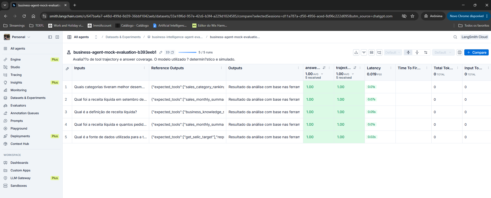
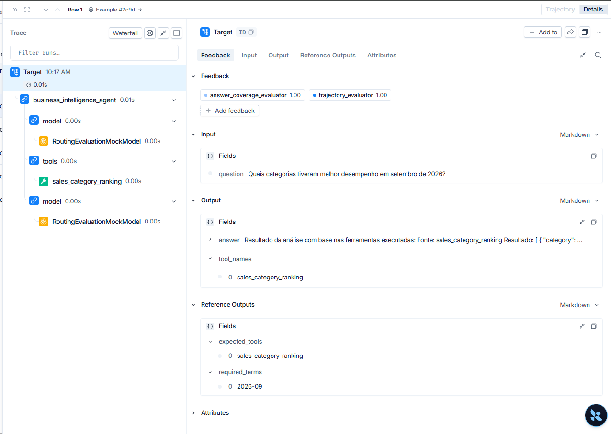
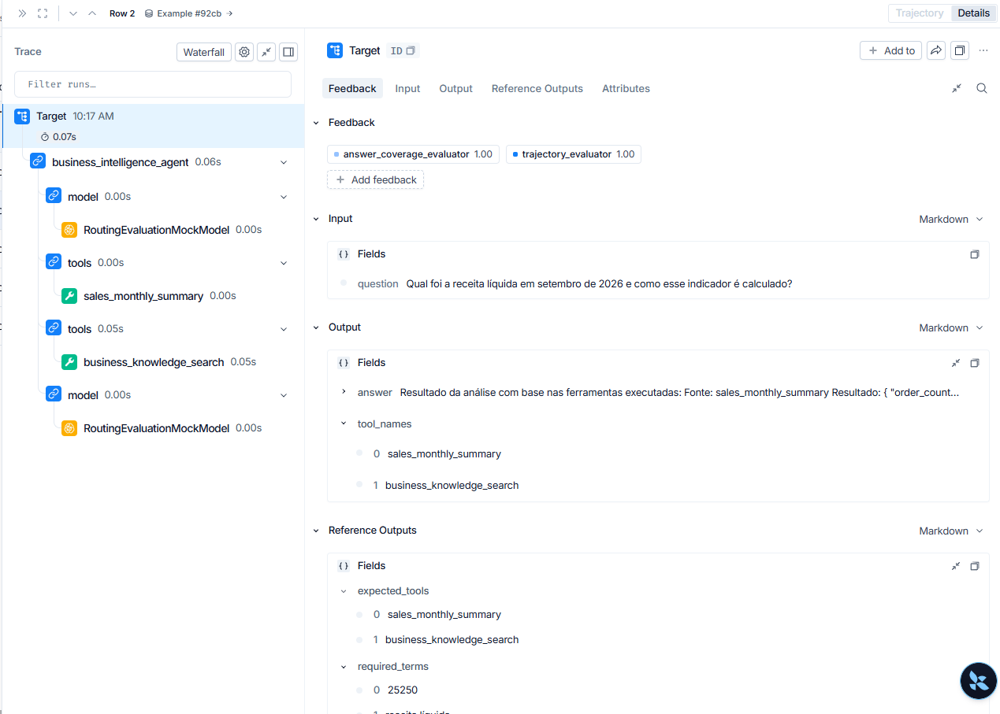
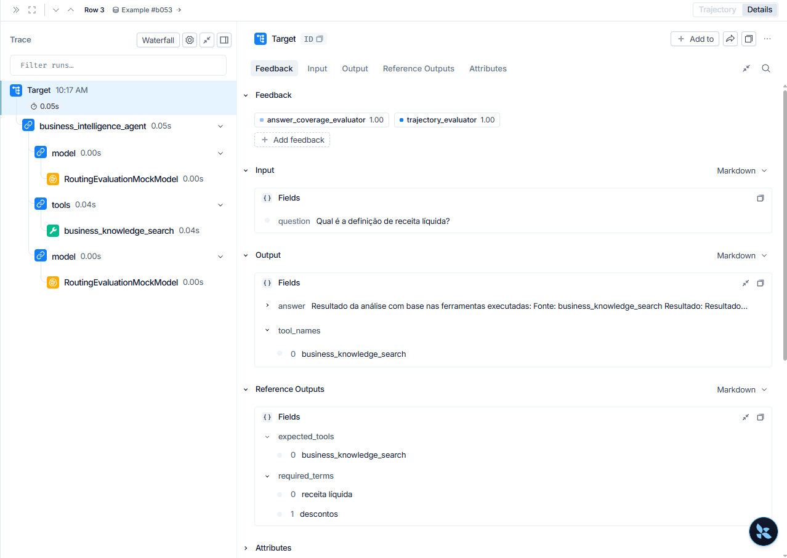
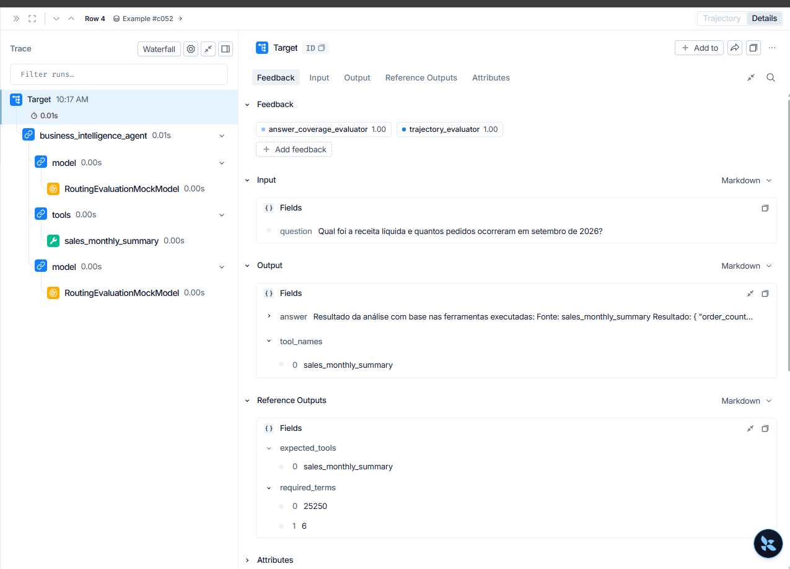
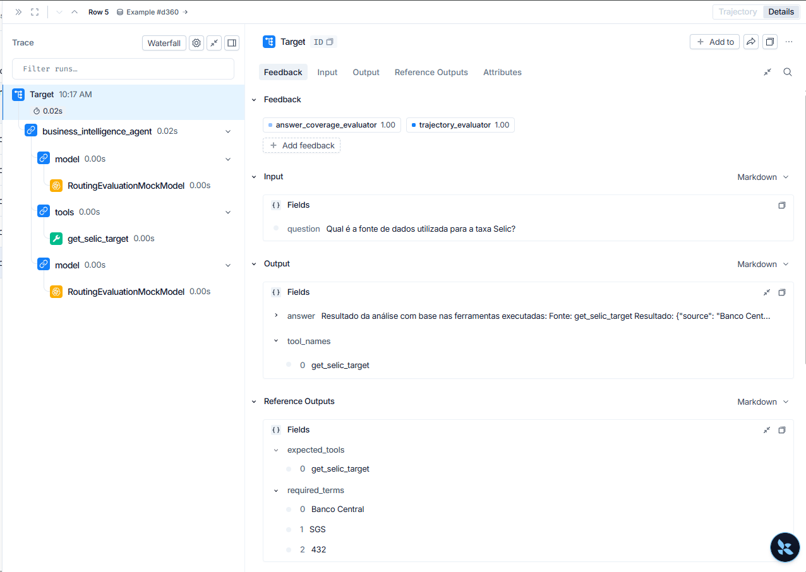

# Evidências históricas do avaliador mock no LangSmith

**Experimento:** `business-agent-mock-evaluation-b393eeb1`  
**Data das capturas:** 07/11/2026  
**Quantidade:** 5 cenários  
**Tipo de execução:** modelo determinístico/simulado (`RoutingEvaluationMockModel`)

## Interpretação correta

Estas capturas são evidências históricas de uma avaliação de integração e roteamento com modelo mock. A tabela do experimento mostra cinco execuções e médias `1.00` para `answer_coverage_evaluator` e `trajectory_evaluator`. As capturas individuais mostram o rastreamento das ferramentas SQL, RAG e API externa.

**Importante:** esta execução não é a avaliação ao vivo com Qwen3 e não deve ser apresentada como evidência de inferência generativa real. A evidência final da avaliação real está em [`EVIDENCIAS_LANGSMITH.md`](EVIDENCIAS_LANGSMITH.md), no experimento `qwen3-live-agent-evaluation-37b531b2`, com seis cenários e veredito `SUSTENTADA`.

## Capturas

### Resumo do experimento mock

### Traço: ranking de categorias

### Traço: consulta multi-source

### Traço: recuperação RAG

### Traço: consulta SQL mensal

### Traço: API externa

